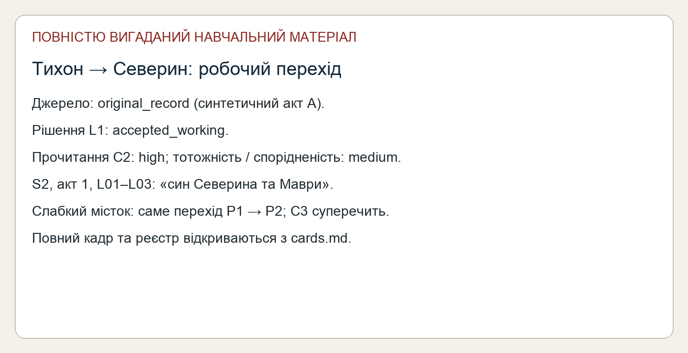
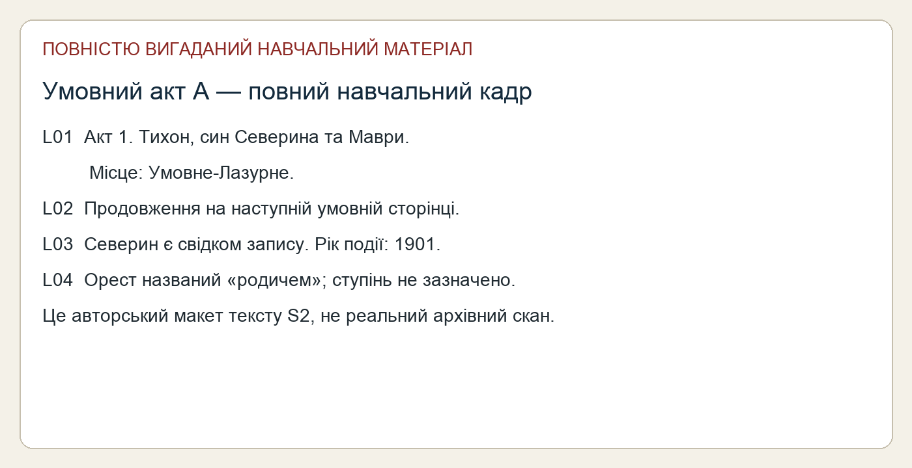
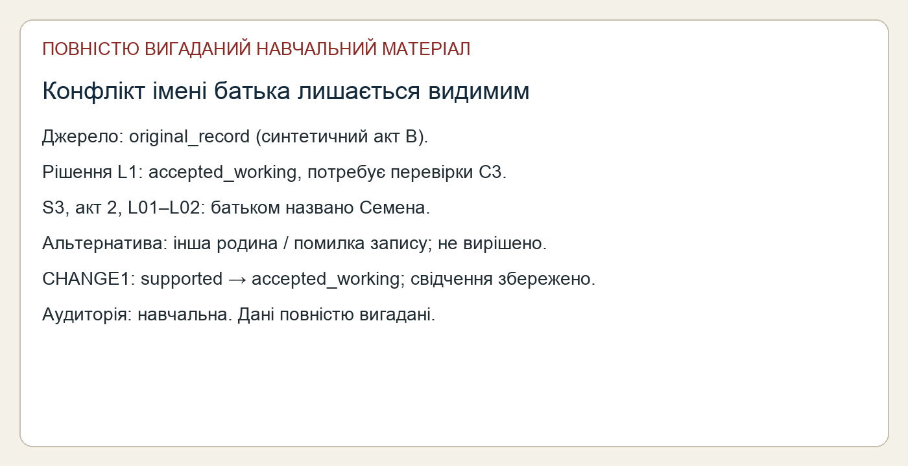
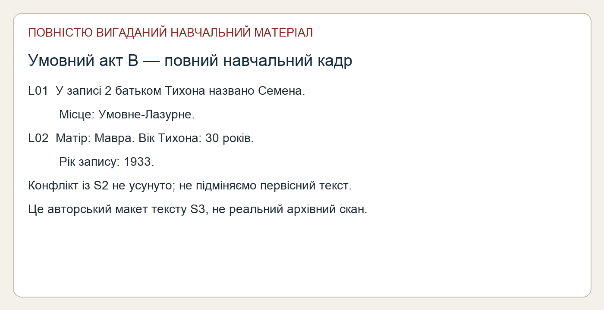

# Дві навчальні картки — зріз 09.11.2026

Повністю вигадані дані. Тема: робочий перехід P1 → P2 і конфлікт імені батька. Найслабший місток — L1; бічна лінія не виводиться. Для справжнього видання living/unknown приховуються; тут імена дозволені лише як очевидно синтетичні.

[Повний навчальний кадр S2](../../originals/act-a.png), [точний текст S2, акт 1 L01–L03](../../transcripts/record-a.txt). Підстава: C2 і L1; тип джерела original_record у синтетичному прикладі, статус рішення accepted_working.

[Повний навчальний кадр S3](../../originals/act-b.png), [точний текст S3, акт 2 L01–L02](../../transcripts/record-b.txt). C3 суперечить C2, CHANGE1 зберігає перегляд L1. [Реєстр L](../../data/links.json), [твердження C](../../data/claims.json).

Медіа — авторські макети, не справжні архівні фотографії. Local: current; deployed: not_deployed. Читабельність потрібно перевіряти на цільовому носії; цей варіант призначений для локального екрана.
